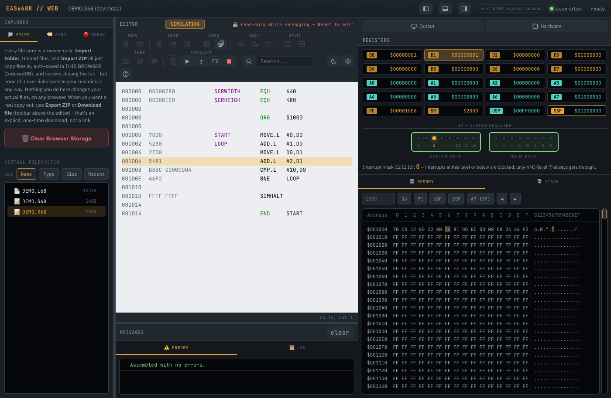
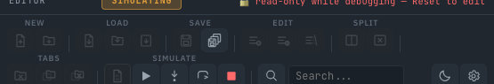

# EASy68K Web

A single-file, browser-based port of EASy68K, the classic Motorola 68000 assembler, simulator, and IDE.



This project compiles the original EASy68K assembler and simulator source to WebAssembly, and wraps it in a from-scratch editor and debugger UI. The result runs entirely in your browser: no install, no server, no account. It is not a reimplementation — the assembler and simulator are the real, original C++ logic, compiled essentially unmodified. Only the parts that need a real Windows GUI (window creation, sound, the filesystem) are replaced with browser equivalents; see [NOTICE.md](NOTICE.md) for exactly what and how much.

## Credits and citation

This web port was created by **Antoni Burguera** (antoni dot burguera at uib dot es) using [Claude Code](https://claude.com/claude-code).

It builds on **EASy68K**, created by **Charles Kelly** ([www.easy68k.com](http://www.easy68k.com/)), itself building on a 68000 assembler originally written by **Paul McKee** (North Carolina State University, 1986). See [NOTICE.md](NOTICE.md) for the full attribution, including one file with its own GPLv2 notice (Jorge Cwik).

> [!IMPORTANT]
> No license file was found with the original EASy68K source. [NOTICE.md](NOTICE.md) states what was and wasn't confirmed. This port's own new code is MIT-licensed, see [LICENSE](LICENSE).

## Contents

- [Try it](#try-it)
- [Documentation](#documentation)
- [Building from source](#building-from-source)
- [Project layout](#project-layout)
- [Requirements](#requirements)
- [Disclaimer](#disclaimer)

## Try it

Grab [`releases/easy68k-web.html`](releases/easy68k-web.html) and open it in any modern browser. That's it — no build step, nothing else to install.

1. Write or import a 68000 assembly program.
2. Click **Assemble**.
3. Click **Run**, or **Step** through it one instruction at a time.



Prefer building it yourself? See [Building from source](#building-from-source).

## Documentation

Two PDF documents live in [`docs/`](docs/), both generated from the application's own in-app Help content, so they can never drift from what the app actually says:

- **[User Manual](docs/user_manual.pdf)** — what every button, panel, and window does, with screenshots, plus the virtual-filesystem warnings.
- **[TRAP #15 Reference](docs/trap15_reference.pdf)** — every TRAP #15 task, fully documented.

Both are also one click away inside the application itself (the **Help** button). See [`docs/README.md`](docs/README.md) if you want to regenerate them after changing the app.

## Building from source

Requires the [Emscripten SDK](https://emscripten.org/docs/getting_started/downloads.html) (`emcc` on `PATH`):

```bash
git clone <this repository's URL>
cd easy68k-web
./build.sh
```

This compiles the assembler and the simulator, then stitches them together with the web frontend into `dist/easy68k-web.html`. If you only changed `src/web/*` (no C++), skip straight to the last step:

```bash
python3 tools/assemble_html.py
```

> [!TIP]
> Both engines compile with `-s SINGLE_FILE=1`, which inlines the WebAssembly binary as base64 directly into the generated `.js` file — this is what lets the whole application ship as one HTML file with no separate `.wasm` to serve.

## Project layout

```
easy68k-web/
├── build.sh              Build script (see above)
├── src/
│   ├── engine-asm/       The assembler's C++ source
│   ├── engine-sim/       The simulator's C++ source
│   └── web/              The browser frontend (HTML/CSS/JS)
├── tools/                Build helper (assemble_html.py)
├── docs/                 User Manual + TRAP #15 Reference (PDF + LaTeX)
├── releases/
│   └── easy68k-web.html  <- ready to download and run, no build needed
└── dist/                 Build output if you build it yourself (gitignored)
    └── easy68k-web.html
```

`src/engine-asm/` and `src/engine-sim/` are the real EASy68K source, essentially unmodified — each has one small addition, `wasm_api.cpp`, a C-linkage adapter exposing it to JavaScript. `src/engine-sim/` also has `simio_stub.h`, which replaces the original's Win32 GDI calls with browser equivalents (canvas drawing, Web Audio, an in-memory filesystem) — what each TRAP #15 task *does* is unchanged, only how it reaches the screen. See [NOTICE.md](NOTICE.md) for the details.

## Requirements

* **To run** a pre-built `easy68k-web.html` (from [`releases/`](releases/) or your own build): any modern browser.
* **To build** from source: the [Emscripten SDK](https://emscripten.org/docs/getting_started/downloads.html) and Python 3. Last built against Emscripten 3.1.x / clang 15.
* **To rebuild the PDFs** in `docs/`: a TeX distribution with `xelatex` — see [`docs/README.md`](docs/README.md).

## Disclaimer

This code is provided as it is, which is to say: it assembles real 68000 machine code inside a web page, a sentence that would have sounded like science fiction to whoever last opened a serial terminal to burn an EPROM. It works today, on the machine it was tested on, under conditions that felt reasonable at the time. Running it may cause spontaneous nostalgia for the 1980's, an irrational urge to write texts in 80 columns, or a newfound appreciation for the phrase "Syntax Error". Use it, fork it, teach a class with it — and if reality briefly flickers while `DIVU` is executed, that's not a bug; that instruction has simply always been more precise than the universe strictly required.
